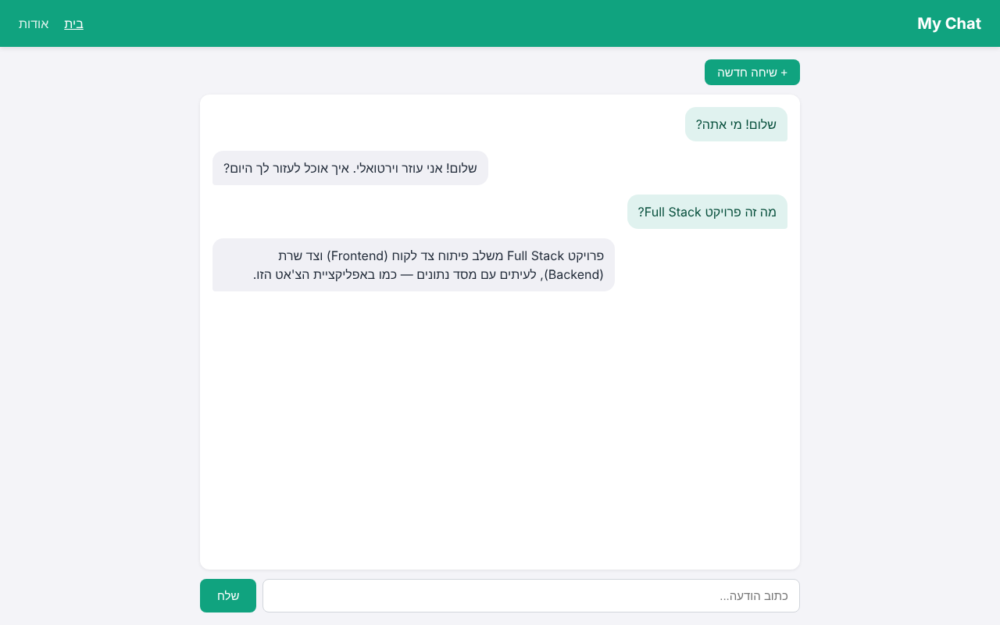

# My ChatGPT

[](https://github.com/yuvaldromi1/my-chatgpt/actions/workflows/ci.yml)

A ChatGPT-style web app: the user holds an ongoing conversation with an AI model, and every conversation is saved to a database. Final project of the John Bryce Full Stack (Python) program.



## Features

- Multi-turn chat: the model receives the full conversation history, so it keeps the context
- Start a new conversation at any time
- Conversations and messages are stored in MongoDB, each message tagged as `user` or `assistant`
- The last conversation is restored after a page refresh (`sessionStorage`)
- The OpenAI API is called only from the server; the API key never reaches the browser

## Tech Stack

**Backend:** Python · FastAPI · Motor (async MongoDB driver) · OpenAI SDK · Pydantic
**Frontend:** React · Vite · React Router · Axios
**Database:** MongoDB
**Testing & CI:** pytest · FastAPI TestClient · mongomock-motor · GitHub Actions

## Architecture

```
React SPA  --REST-->  FastAPI  --> MongoDB (conversations, messages)
                         |
                         +------> OpenAI API (gpt-4o-mini)
```

## API

| Method | Endpoint | Description |
|--------|----------|-------------|
| POST | `/api/conversations` | Create a conversation, returns `conversationId` |
| POST | `/api/conversations/{id}/messages` | Send a user message and get the assistant's reply |
| GET | `/api/conversations/{id}/messages` | Get the conversation history |

Interactive API docs: `http://localhost:8000/docs`

## Database (MongoDB `chatgpt_db`)

- **conversations**: `{ _id, title, createdAt }`
- **messages**: `{ _id, conversationId, role: "user" | "assistant", content, createdAt }`

## Run Locally

**Requirements:** Python 3.11+, Node.js 20+, MongoDB running on `localhost:27017`, an OpenAI API key.

1. Restore the sample data (optional):
   ```bash
   mongorestore --db chatgpt_db Database/chatgpt_db
   ```
2. Backend:
   ```bash
   cd Backend
   python -m venv venv
   venv\Scripts\activate          # macOS/Linux: source venv/bin/activate
   pip install -r requirements.txt
   copy .env.example .env         # then set OPENAI_API_KEY
   uvicorn main:app --reload
   ```
3. Frontend:
   ```bash
   cd Frontend
   npm install
   npm run dev
   ```
4. Open `http://localhost:5173`

## Tests & CI

```bash
cd Backend
pip install -r requirements-dev.txt
pytest
```

11 API tests run against an in-memory MongoDB with the OpenAI call mocked, so they need no database, no API key and no network. They cover creating conversations, saving the history in order, sending the full history to the model, isolation between conversations and error handling (400, 404, 422, 502).

On every push, GitHub Actions runs the backend tests and builds the frontend.

## What I Learned

- Designing a REST API in FastAPI with Pydantic models and async database access
- Managing conversation context for an LLM: sending the stored history with every request
- Keeping secrets on the server side and out of version control

## Author

Yuval Dromi · [GitHub](https://github.com/yuvaldromi1)
